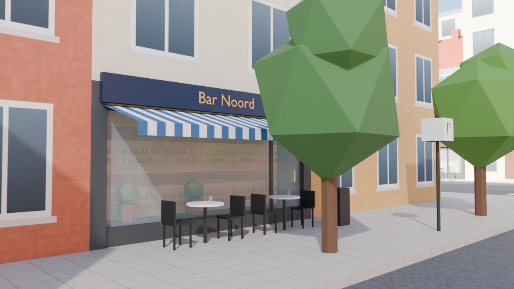

# Boodschappen in Ministad

Een spelletje in een kleine, levendige stad, gebouwd met Blender: wie haalt het snelst alle
boodschappen van het lijstje?



## Het spel

1. Typ je naam, kies een jongen of een meisje en de kleur van je kleren.
2. Je krijgt een lijstje met 6 boodschappen en wat geld in je portemonnee.
3. Druk op **Start!**: de chronometer begint te lopen.
4. Volg de tekentjes boven de winkels en op de kaart. Open de deur (`E` of de knop onderaan),
   loop naar de toonbank en koop wat je nodig hebt. Op je lijstje wordt die lijn doorstreept.
5. Alles gekocht? Je tijd komt op het **scorebord** (de 10 snelsten, bewaard in de browser).
   Koop je te veel en heb je niet genoeg geld meer voor je lijstje, dan is het spel uit.

Iedereen speelt standaard met hetzelfde **wedstrijdlijstje**, zodat de tijden eerlijk te vergelijken
zijn. Met *🎲 Ander lijstje* krijg je een nieuw lijstje met een eigen scorebord.

In de winkels staan een winkelier (die je bij naam begroet, als je browser Nederlands kan
spreken) en soms andere klanten. Alle geluiden worden in de browser gemaakt: voetstappen, de
deurbel, de kassa, munten, het potlood, verkeer, fietsbellen, vogels en duiven.

Met **📻** (of `R`) zet je de radio op: de Spotify-speler met de playlist van Ministad. Wie in die
browser bij Spotify is ingelogd, hoort hele nummers, anders stukjes van 30 seconden. De speler
wordt pas geladen als je hem opent.

## Wat is er te zien?

**De stad** (`blender/bouw_stad.py`)
- 5 × 5 bouwblokken met rijhuizen in allerlei kleuren en hoogtes, zadeldaken met schoorstenen,
  platte daken, balkons met plantjes, voordeuren en bloempotten
- winkels met een etalage waar je in kan kijken: bakker, slager, boekhandel, apotheek (met groen kruis),
  kapper (met draaipaal), bloemen, groenten en fruit, speelgoed, mode, optiek, fietsen, chocolatier...
- cafés, bars en restaurants met terrassen, parasols, krijtborden en glazen op tafel
- zonneschermen, uithangborden met de naam van de zaak (echte tekst uit Blender)
- een park met fontein, speeltuin (schommel, glijbaan, wipwap) en een ijskar
- een kerkplein met kerk, klokkentoren, marktkramen, een reclamezuil en paaltjes
- een zakenwijk met twee glazen torens, een koffiekiosk en een fietsenstalling
- straten met zebrapaden, putdeksels, lantaarns met straatnaambordjes, bushaltes, prullenbakken,
  fietsenrekken, brievenbussen, brandkranen, bloembakken, parkeerborden en laanbomen

**De bewoners** (`blender/bouw_figuren.py`, tot leven gewekt door `leven.js`)
- voetgangers die over de stoep wandelen, bij het zebrapad kijken voor ze oversteken,
  even voor een etalage blijven staan, of gewoon joggen
- mensen met hun hond aan de leiband, kinderen en een hond die in het park rondrennen
- mensen op de terrassen, op bankjes en in het bushokje, groepjes die staan te praten
- katten op de stoep die je nakijken, duiven op het plein die opvliegen als je te dichtbij komt
- auto's, taxi's, fietsers, bakfietsen (soms met een kind in de bak), scooters en twee stadsbussen
  (lijn 12) die stoppen aan de haltes. Iedereen rijdt rechts, geeft voorrang op de kruispunten
  en stopt voor voetgangers. Het is levendig, maar niet druk.

## Rondlopen

Open `ministad/index.html` via een webserver (de pagina laadt de `.glb`-bestanden, dus
dubbelklikken op het bestand werkt niet). Vanuit de hoofdmap van de repository:

```bash
python3 -m http.server 8000
```

en ga dan naar <http://localhost:8000/ministad/>. Of zet GitHub Pages aan voor deze branch.

| Computer | Telefoon of tablet |
| --- | --- |
| `W A S D` of pijltjes (azerty: `Z Q S D`): lopen | links slepen: lopen |
| `E`: deur openen, kopen, `1`–`4`: snel kopen | knop onderaan: deur openen of kopen |
| muis: rondkijken, scroll: zoomen | rechts slepen: rondkijken |
| `Shift`: rennen, `Spatie`: springen | rechts dubbeltikken: springen |
| `V`: door zijn ogen of achter het mannetje | knop bovenaan: door zijn ogen |
| `M`: kaart, `R`: radio, `Esc`: pauze | knop linksonder: pauze |

Je botst tegen gebouwen, bomen, lantaarns, auto's en mensen. De camera blijft uit de muren
en bladeren vlak voor de camera worden doorzichtig.

## De stad en de bewoners opnieuw bouwen in Blender

Voer de scripts uit vanuit de map `ministad/`:

```bash
blender --background --python blender/bouw_stad.py
blender --background --python blender/bouw_figuren.py
```

Of zonder Blender-programma, met de `bpy`-module (Python 3.11):

```bash
python3.11 -m pip install bpy
python3.11 blender/bouw_stad.py
python3.11 blender/bouw_figuren.py
```

Voeg `-- --render` toe om ook de voorbeeldbeelden te renderen (Cycles op de CPU, een paar minuten),
of bv. `-- --render winkels` voor één beeld.

| Bestand | Inhoud |
| --- | --- |
| `blender/gereedschap.py` | gedeelde hulpjes: texturen tekenen met numpy, materialen, dozen, daken, wielen, tekst |
| `blender/ministad.blend` | de stad, met een collectie per wijk, een zon, lucht en camera |
| `blender/figuren.blend` | alle figuren naast elkaar, elk met draaipunten in de gewrichten |
| `ministad.glb` | de stad voor de browser (met Draco-compressie) |
| `figuren.glb` | mens, hond, kat, duif, fiets, bakfiets, scooter, auto, taxi en bus |
| `botsing.json` | obstakels, zitplaatsen, kattenplekjes, de busroute en haltes, het park, het plein en alle winkels (deur, toonbank, winkelier...) |

Wil je een andere stad? Verander `ZAAD` bovenaan `bouw_stad.py`, of speel met `BLOKKEN`,
`BLOK`, `WEG`, de lijst `WINKELS` en de bijzondere blokken `PARK`, `PLEIN` en `ZAKEN`.

## Hoe het werkt

- `wandel.js` laadt alles, voegt de ~900 stadsobjecten per materiaal samen (een vijftigtal
  tekenopdrachten), en bestuurt het mannetje en de camera.
- `figuren.js` kloont de figuren uit `figuren.glb`, geeft elke persoon andere kleuren
  (huid, kleren, haar, pet, helm, rugzak) en zet ze in een houding: stappen, rennen, staan,
  praten, zitten, fietsen.
- `spel.js` is het spel: het lijstje (met een vast toevalszaad, zodat hetzelfde nummer altijd
  hetzelfde lijstje geeft), het geld, de chronometer, de deuren, winkeliers en klanten, het
  winkelscherm, de tekentjes en het scorebord.
- `geluid.js` maakt alle geluiden met Web Audio, zonder geluidsbestanden.
- `leven.js` is de stad zelf: een wegennet waarop elk kruispunt één voertuig tegelijk binnenlaat,
  voertuigen die afstand houden en alleen een kruispunt oprijden als er erachter plaats is,
  voetgangers die over de stoepen van blok naar blok lopen, en de dieren.
