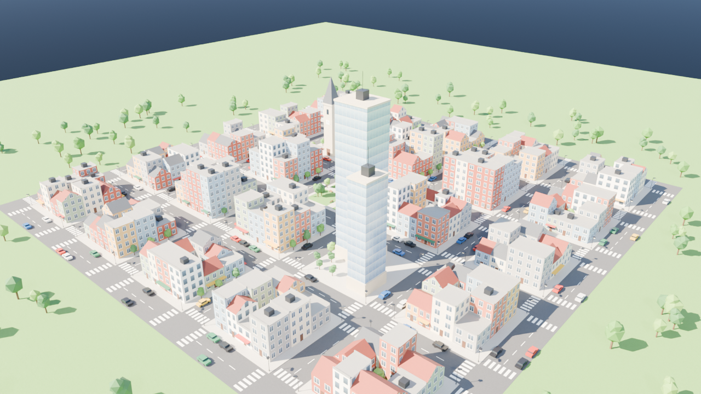
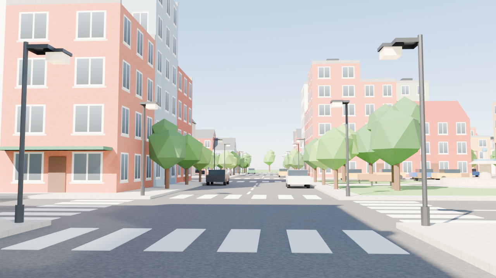

# Ministad

Een kleine stad, gebouwd met Blender, waarin je in de browser kan rondwandelen.




## Wat staat er in de stad?

- 5 × 5 bouwblokken met rijhuizen in verschillende kleuren, hoogtes en daken
  (zadeldaken en platte daken), voordeuren, luifels en binnenkoeren met een boom
- een **park** in het midden met een fontein, paden, bomen en banken
- een **kerkplein** met een kerk, een klokkentoren en een standbeeld
- een **zakenwijk** met twee glazen torens
- straten met middenlijnen, zebrapaden, straatlantaarns, laanbomen en geparkeerde auto's
- een bosrand rondom de stad

## Rondwandelen

Open `ministad/index.html` via een webserver (de pagina laadt `ministad.glb`, dus
dubbelklikken op het bestand werkt niet). Vanuit de hoofdmap van de repository:

```bash
python3 -m http.server 8000
```

en ga dan naar <http://localhost:8000/ministad/>.

| Computer | Telefoon of tablet |
| --- | --- |
| `W A S D` of pijltjes (azerty: `Z Q S D`): wandelen | links slepen: wandelen |
| muis: rondkijken | rechts slepen: rondkijken |
| `Shift`: lopen, `Spatie`: springen | rechts dubbeltikken: springen |
| `M`: kaart aan/uit, `Esc`: pauze | knop linksboven: pauze |

Je botst tegen gebouwen, bomen, lantaarns, banken en auto's, en stapt vanzelf de stoep op.

## De stad opnieuw bouwen in Blender

Alles komt uit één script: [`blender/bouw_stad.py`](blender/bouw_stad.py).
Voer het uit vanuit de map `ministad/`:

```bash
blender --background --python blender/bouw_stad.py
```

Of zonder Blender-programma, met de `bpy`-module (Python 3.11):

```bash
python3.11 -m pip install bpy
python3.11 blender/bouw_stad.py
```

Voeg `-- --render` toe om ook de voorbeeldbeelden te renderen (Cycles, ongeveer 1,5 minuut op de CPU).

Het script maakt:

| Bestand | Inhoud |
| --- | --- |
| `blender/ministad.blend` | het Blender-bestand, met een collectie per wijk, een zon, lucht en camera |
| `blender/texturen/*.png` | gevels, dakpannen, asfalt, stoeptegels, gras en steen, met numpy getekend |
| `ministad.glb` | de stad voor de wandelpagina |
| `botsing.json` | de obstakels (rechthoeken), het startpunt en het stratenplan voor de kaart |

Wil je een andere stad? Verander `ZAAD` bovenaan het script, of speel met `BLOKKEN`,
`BLOK`, `WEG` en de bijzondere blokken `PARK`, `PLEIN` en `ZAKEN`.

## Hoe de wandelpagina werkt

- `wandel.js` laadt de stad met three.js en voegt alle onderdelen met hetzelfde materiaal
  samen, zodat de ~730 Blender-objecten in een veertigtal tekenopdrachten passen.
- De zon volgt de wandelaar, zodat de schaduwen dichtbij scherp blijven.
- Botsen gebeurt met een cirkel (de wandelaar) tegen de rechthoeken uit `botsing.json`;
  je glijdt langs muren in plaats van vast te lopen.
