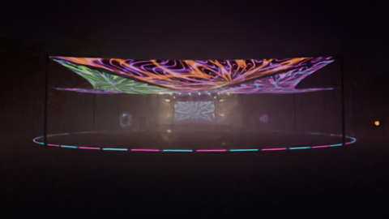
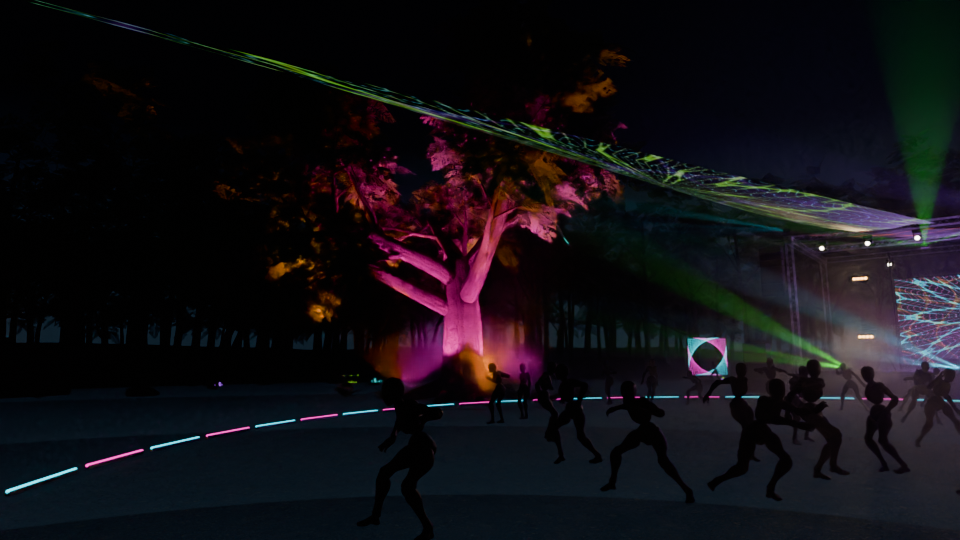
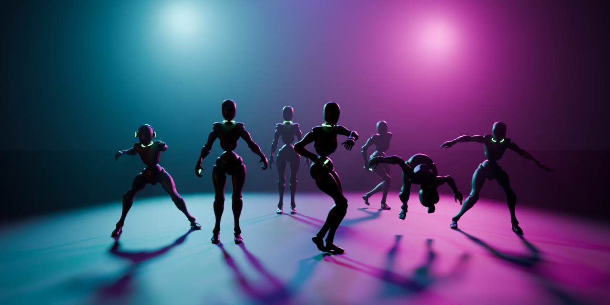

# Rave against the machine

Een openlucht Goa- en psytrancefeest bij nacht, op een open plek in het bos, gebouwd met Blender.
In de browser loop je rond tussen de dansers. Het licht, de lasers en de dansers reageren op de muziek.





## Rondlopen

Vanuit de hoofdmap van de repository:

```bash
python3 -m http.server 8000
```

en ga dan naar <http://localhost:8000/rave/>.

- `W A S D` of de pijltjes (azerty: `Z Q S D`): lopen. Met de muis kijk je rond.
- `Shift`: rennen, `Spatie`: springen.
- `E`: dansen, `R`: salto.
- `V`: door de ogen kijken, `M`: kaart, `Esc`: pauze.
- `T`: meetikken op de beat.

**Muziek:** open het muziekpaneel en start het Spotify-album. Klik dan op "Laat de wereld meeluisteren".
De pagina luistert via de microfoon mee met je luidsprekers, zodat het licht op de echte beat reageert.
Zonder microfoon (of met een koptelefoon) loopt alles op een vast tempo van 142 BPM.

Debugparameters: `?fase=basis|opbouw|drop`, `?bpm=`, `?kwaliteit=hoog|licht` en `?auto`.

## Opnieuw bouwen in Blender

Vanuit de map `rave/` (met de `bpy`-module, Python 3.11):

```bash
python3.11 blender/bouw_rave.py      # terrein: rave.glb + botsing.json (downloadt CC0-texturen van Poly Haven)
python3.11 blender/bouw_figuren.py   # dansers: figuren.glb (Mixamo-bestanden nodig in blender/bronnen/mixamo/)
```

Voeg `-- --render` toe om ook de voorbeeldbeelden te renderen.

De Mixamo-bronbestanden staan niet in de repository: die mogen we niet verder verspreiden.
Wat elk onderdeel van de andere verwacht, staat in [AFSPRAKEN.md](AFSPRAKEN.md).
